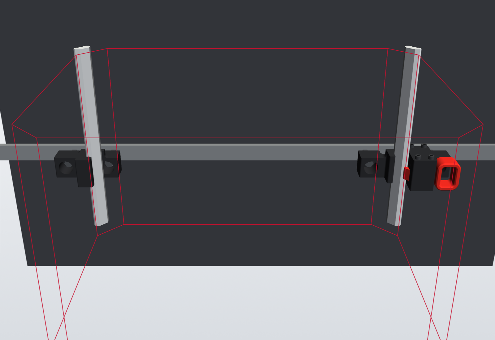
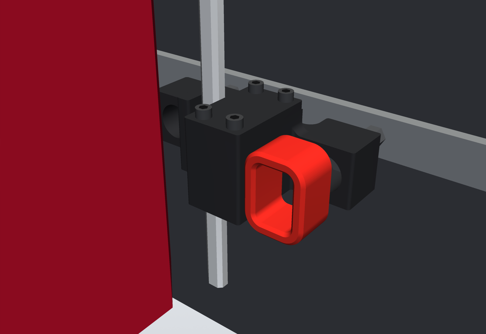
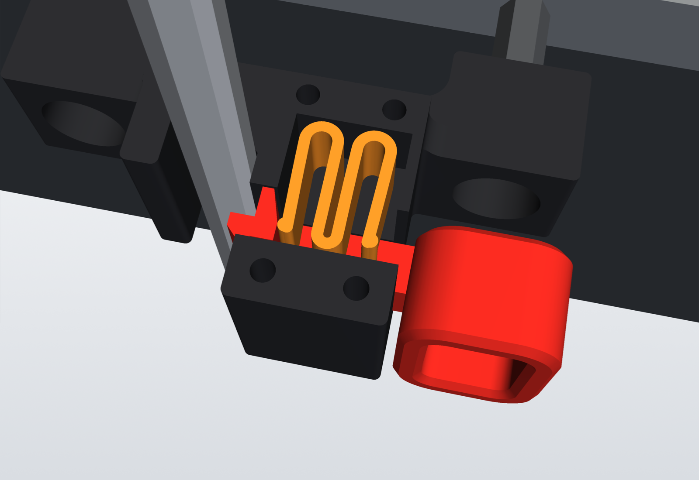
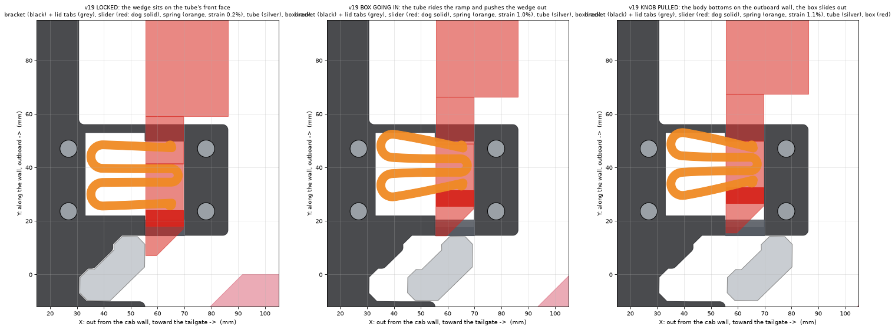

# packout-stack-lock

3D-printed (ASA) hardware that holds a Milwaukee Packout XL box against the cab wall of a truck bed. It grabs the box's rear corner tubes and bolts to horizontal L-track.

- **Latch:** goes on one rear corner. Push the box in and it clips itself; pull the handle to let it go. No tools either way.
- **Hook:** a static part for the other corner. Slide that corner's tube into the hook, then swing the box back into the latch.



The box is outlined in red, with its two rear corner tubes in silver. The hook is on the left, and the latch with its red pull handle is on the right. Both bolt to the same L-track.

Each `vN/` folder is a full design iteration. The current one is **[v19](v19/README.md)**. The parts are modeled in Python with build123d, the plan views come from shapely and matplotlib, and the renders from pyvista.

```
uv sync
uv run python v19/latch.py --check
uv run python v19/latch.py && uv run python v19/plan.py && uv run python v19/render.py
```

STLs and STEPs land in `v19/out/`, images in `v19/renders/`.

## The latch



The black bracket bolts to the L-track and has a pocket for the box's aluminum corner tube. A red slider runs in a lane across the pocket's mouth, along the track. Its wedge sits in front of the tube's face, so the box can't pull away from the wall.



These are the parts that move inside the latch (shown here with the lid off):

- **Slider (red):** a wedge on one end, the D-handle on the other. In between is a dog (a tab) that pushes on the spring.
- **Spring (orange):** a printed W spring with four flat arms. It sits in a well between the slider's dog and a tab on the lid, and pushes the slider toward the tube.
- **Stops:**
  - Out: a shoulder on the slider lands on a sill at the mouth, so the spring can't push the wedge too far.
  - In: the slider's body bottoms on the outboard wall when you pull the handle all the way.
- **Lid:** holds it all in, with 4 × M6 × 60 cap screws into nuts pocketed in the bottom.



The plan view, from above, shows the three states:

1. **Locked:** the wedge covers the tube's face. A yank on the box pushes the wedge into solid bracket, not into the spring.
2. **Box going in:** the tube hits the wedge's 45° ramp and pushes the slider back against the spring. Once the tube is past, the spring snaps the wedge back over it.
3. **Handle pulled:** the slider pulls back 8 mm, the wedge clears the tube's path, and the box swings out.

## Repo layout

- `vN/latch.py`: all the geometry, plus `--check`, which runs the interference, clearance, strength and min-wall checks.
- `vN/plan.py`, `vN/render.py`: the images.
- `vN/README.md`: what changed in that version, the hardware, and print and install notes.
- `printcheck.py`, `jointcheck.py`: overhang and sharp-inside-corner checks on any STL.
- `ref/`: reference models (not committed).
