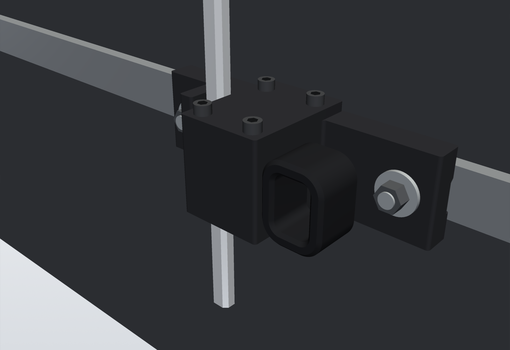
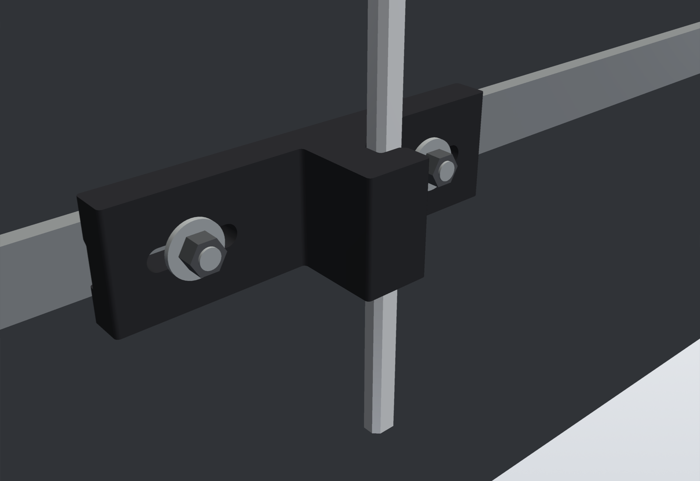

# v12: L-track mount + static hook at the other corner

v11's latch (same slider, spring, lid and stops), moved onto horizontal L-track, plus a static **hook** for the box's other rear corner.

```
uv run python v12/latch.py --check
uv run python v12/latch.py && uv run python v12/plan.py && uv run python v12/render.py
```





## How it goes in and out

- **In:** with the box pushed back against the wall, slide the hook-side corner sideways into the hook. Then swing the other side back, pivoting on that corner. The latch side rides the ramp and clicks.
- **Out:** pull the handle, swing that side out, then slide the box sideways off the hook.
- **What holds it:** the hook stops the box going back, forward and toward its side. The latch stops back, forward and toward the other side. Together the box is held flat on the wall in every direction.
- **Swing room:** the hook lets the tube turn ±2.5° while the box swings. The latch side only needs ~2° of swing to reach the ramp.

## Mounting

- **Two 3/8"-24 stud fittings per part, both in the same horizontal track.**
  - Latch: **6" apart, round holes**. Rigid, with zero slop on the part that takes the hits.
  - Hook: **5" apart, slots with 30 mm of travel**. L-track only gives 1" steps, so the slots cover any box spacing. Put the hook's fittings in the track holes nearest the right spacing and slide the hook to fit.
  - Both stud pairs straddle their block, so the box's pull lands *between* the studs instead of levering the plate off the track.
  - Each plate is symmetric about its studs. Both plates are ~195–200 mm long.
- **The back face bears on the track, not on the fittings.** A 22 mm wide × 3.5 mm deep groove runs along the back to clear the fittings' tops. That way, tightening each nut pulls the fitting's lugs up into the track's lips, which is what locks it in. If a fitting bottoms against the bracket instead, the fitting can rattle in the track.
- **Lid:** a plain rounded rectangle over the block only. The plate's wings print as part of the bracket at the plate's height.
- **Leg 18 mm thick** (was 10). The back face moved toward the wall, and everything holding the box stayed put.
  - From the back face to the box is now 37.2 mm. A 30 mm stud clears the box by 3.7 mm even if a fitting stands 3.5 mm proud into the groove.
  - After the leg, a washer and a nut, there's about 1 mm of stud left over, so the nut is fully engaged.

## Hardware

- 4 × L-track double-stud fittings (3/8"-24 × 30 mm): 2 per part.
- 4 × 3/8"-24 **plain** hex nuts + 4 × 3/8" USS flat washers (1" OD). Add blue threadlocker, or use a split lock washer.
  - A nyloc is ~11 mm tall and won't fully reach its nylon ring here.
  - A serrated flange nut also works, without the washer.
- Latch block, same as v11: 4 × M6 × 60 cap screws + 4 plain M6 nuts.

## Print

| part | orientation | material |
|---|---|---|
| `out/bracket.stl` | standing, as exported | ASA or ASA-CF |
| `out/lid.stl` | top face down, as exported | ASA or ASA-CF |
| `out/slider.stl` | lying on its latch face, as exported | plain ASA |
| `out/spring.stl` | flat, as exported | plain ASA |
| `out/hook.stl` | standing, as exported | ASA or ASA-CF |

- **`hook.stl` is already mirrored for the other corner. Don't mirror it again.**
- **Use 100% infill on the legs**, or at least a modifier around the stud holes, so you can crank the nuts. Snug plus a quarter turn is plenty, and re-torque after the first hot week.
- **No supports.** The overhangs are the round stud holes, the hook's horizontal slots (like the E-track slots you've printed), and the nut-pocket bridges. The groove's top edge is a 45° slope.
- **Weights** in ASA: bracket ~336 g (the thicker leg and longer plate), hook ~265 g, lid 29 g, slider 59 g, spring 13 g.

## Guesses to check when you have the parts

- **Fitting height:** I assumed the fittings stand at most 3.5 mm above the track (the groove's depth). If they're taller, tell me and I'll deepen the groove.
- **Track width:** I assumed 1.25". The bracket bears on the track either side of the 22 mm groove.
- **Stud length:** 30 mm above the fitting, per the listing.
- **Box spacing:** the hook's slots cover it. It doesn't need to be known.
