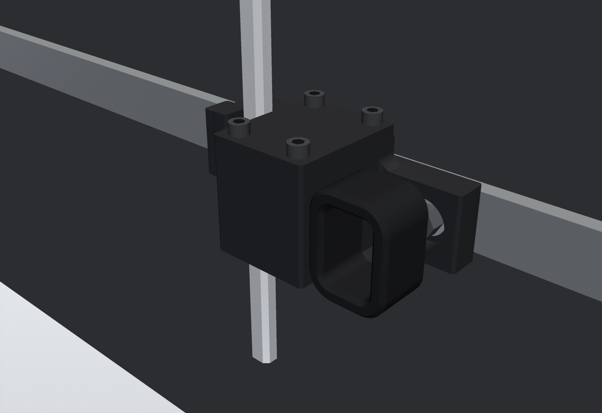
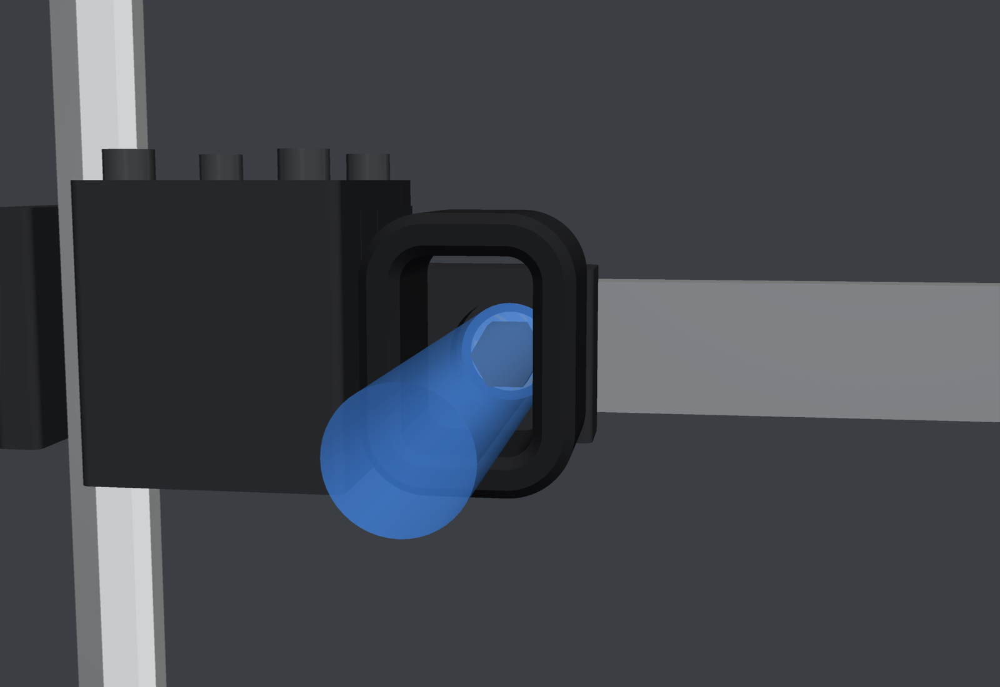
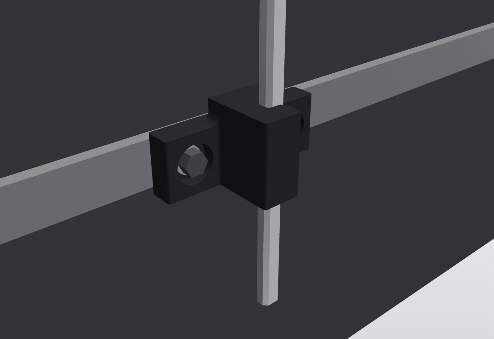

# v14: fitted to the truck

v13, tuned from your first install on the L-track: the hook is placed from measurements, the latch's foot is an inch shorter on the handle side, a socket reaches through the handle, and the spring is softer. **The lid is unchanged** (byte-for-byte the same file as v13).

```
uv run python v14/latch.py --check
uv run python v14/latch.py && uv run python v14/plan.py && uv run python v14/render.py
```





## What changed from v13

- **Hook holes placed from your measurements, round, no slop.**
  - With **21 5/8"** between the two parts' side walls, the hook's holes land exactly on the same 1" track grid as the latch's.
  - **Where the fittings go:** the hook's holes are **3" apart**, at **18" and 21"** along the track from the latch's inboard fitting.
  - The hook's foot is **116 mm** long (v13's: 195).
  - **The inner hole sits right where the box's arm slides in sideways.** It fits because:
    - The hook's lip now bites 5.2 mm of the arm's face, the same as the latch's wedge (it was 6.7). So the arm only has to slide **11 mm** sideways to get behind the lip.
    - Over that slide, the arm's flat back face stops about **0.7 mm short** of the kit nut, which stands 0.75 mm proud of the foot.
    - That means: set the box against the wall about ½" short of the hook, then slide it in. Don't start the slide from much further over, or the arm can ride over that nut.
  - The hook block is a little narrower (16 mm, was 20), so the outer hole could take the closer grid spot.
  - **Cross-check:** your two measurements disagree by about 2.5 mm. With 21 5/8" between the walls, the v13 parts' facing ends should have been 15.47" apart, and you measured 15 3/8". These holes trust the 21 5/8". If the hook comes out off, give me the offset and it's one number.
- **Latch's handle-side hole is 1" closer: holes 5" apart** (were 6"). The foot ends an inch sooner on the handle side, so the bracket can sit an inch nearer the end of the track. The foot is 167 mm long (v13's: 190).
- **A socket reaches that nut through the handle.**
  - The handle's hole is opened down and outward, to 25.3 × 38 mm. A socket up to **23 mm across** (the common 3/8"-drive 9/16" and 5/8" sizes are about 22) goes straight through it to the handle-side nut with the slider locked. No need to pull the lid or the M6 bolts.
  - The bar around the hole is still an even 8 mm, with concentric corners.
  - The foot is 40 mm tall (was 38), with the studs at its center (z = 20), so the opened handle still sits flush with the bracket's bottom.
- **Spring ~1/3 softer:** arms 3.5 → 3.05 mm. Stiffness scales with thickness cubed, so (3.05/3.5)³ = 0.66.
  - The spring keeps the same outline: same centerlines, same nub tips. So the well, the lid tabs and the lid don't change.
  - Peak strain drops from 1.5% to 1.3%.
  - Estimated in ASA: about 7 N locked, 28 N fully pulled. The peak push to latch is about 65 N (v13: about 95 N).
- **Mounting stack:** the counterbore web is set from your measured ¾" stud and ⅜" kit nut + washer, leaving **9.2 mm** of web. The stud passes the whole nut.

## Install

1. **Latch:** two fittings 5" apart, then the kit's nut and washer in each counterbore.
2. **Hook:** count along the track from the latch's inboard fitting. Put the hook's fittings at **18" and 21"**, then mount the hook, which is already mirrored for the other corner.
3. Set the box against the wall about ½" short of the hook, slide it into the hook, then swing the other side back into the latch.
4. To tighten the latch's handle-side nut later, put the socket through the handle's hole with the slider locked.

## Print

Same as v13: bracket and hook standing, the lid top-face down (reuse your v13 lid), the slider on its latch face, the spring flat. Slider and spring in plain ASA. Use 100% infill around the counterbores, the M6 nut pockets and the front cheek, and 50% everywhere else.

Solid weights: bracket ~277 g, hook ~151 g, slider 64 g, spring 12 g.
