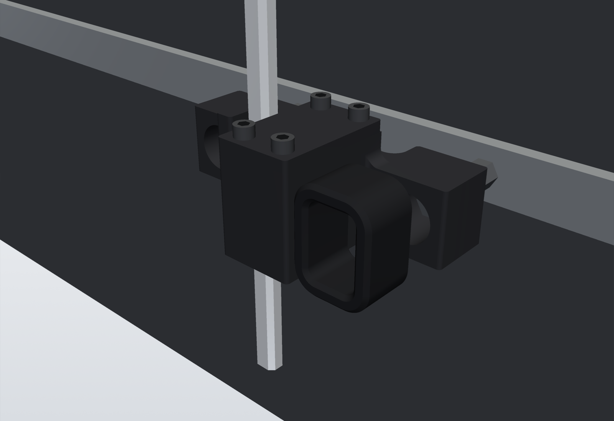
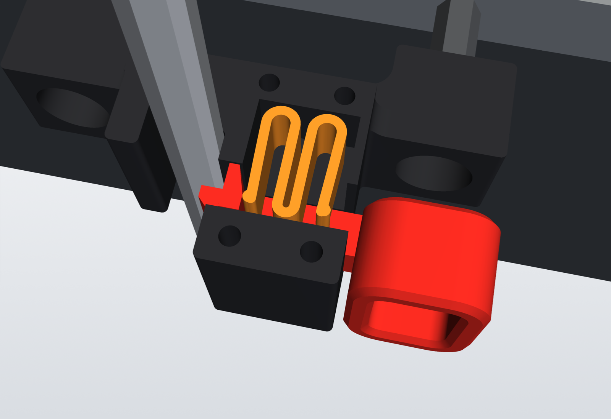
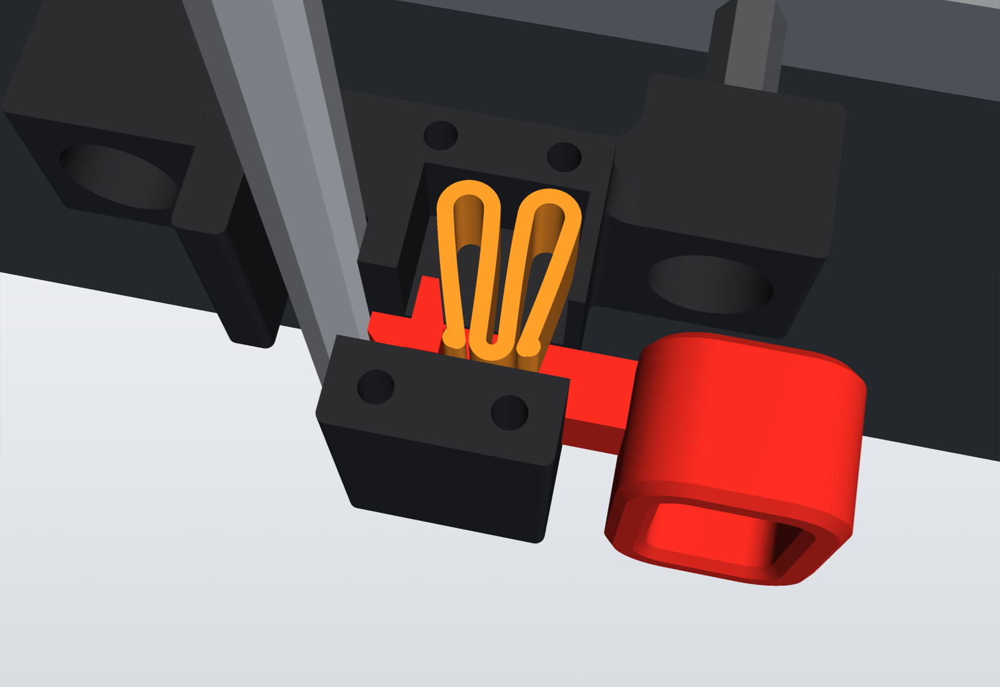
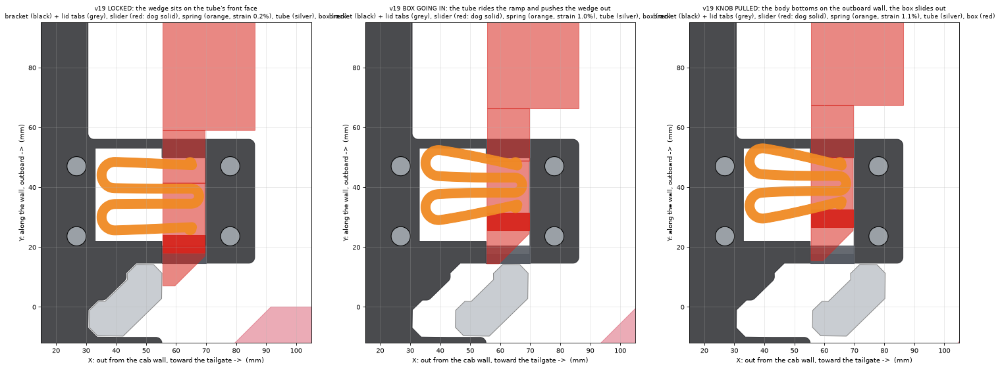
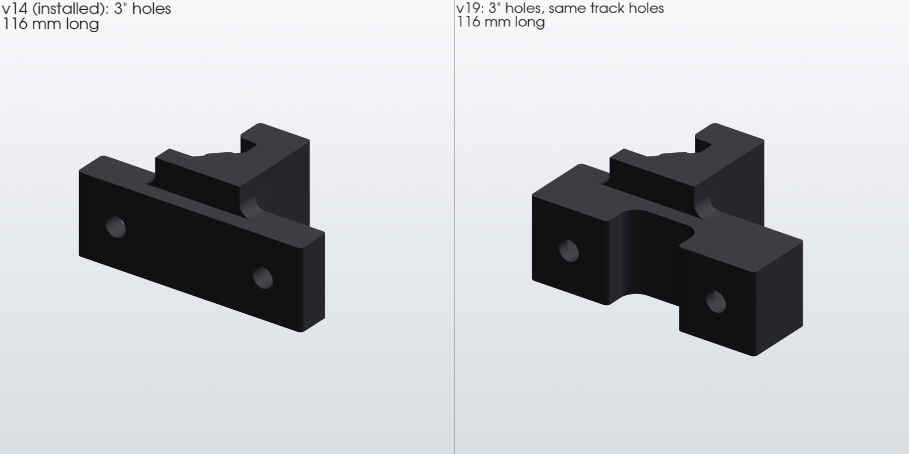

# v19: v16 with a ~½" narrower latch block

Same mechanism as v16. Push the box in and it clips itself; pull the handle to let it out, no tools either way. The block that holds the slider and spring is **41.4 mm** along the track (v16: 53.5), so **12.1 mm (0.48") narrower**. The studs stay in the same track holes, and the handle stays in the same spot.

```
uv run python v19/latch.py --check
uv run python v19/latch.py && uv run python v19/plan.py && uv run python v19/render.py
```






## What changed from v16

- **The box sits 0.48" closer to the latch.** The tube pocket and the box moved toward the latch by the same amount the block shrank. The studs and the handle didn't move, so the socket still reaches the outer nut through the handle (0.5 mm to spare).
- **The wedge bites 4.2 mm of the tube's face** (was 5.2). That cuts the stroke needed to clear the tube to 8.0 mm, and the handle travels 8.5.
- **The spring box is squeezed:**
  - The gaps between the arms are smaller.
  - The contact nubs are 1 mm (were 4).
  - The dog's face and the lid tab's face are angled back 18° below where the spring touches them, so the end arms can tilt without hitting them. Both faces are still ≥ 3 mm thick at the root.
  - Fully pulled, the spring swivels ~4.5° in its well and still clears every wall by ≥ 0.43 mm.
- **Spring:** same 3.05 mm arms and 20 mm height, shorter. Estimated in ASA: **4.5 N locked, 23.5 N fully pulled** (v16: 6.6 locked), 1.1% peak strain. The peak push to latch is about 55 N.
- **Hook:** regenerated for the new box position, with holes **3" apart, at 18" and 21"** from the latch's inner hole. Those are **the same track holes as your installed v14 hook**, so its fittings don't move. The hook is 116 mm long, the same as v14's.
  - The block sits 12.1 mm closer to the latch than v14's, following the box. So v14's hook doesn't fit, but its fittings stay.
  - The inner well's opening is partly behind the tube: about 7 mm of the Ø26 opening is where the tube rests and slides in. That's fine, because the nut sits 20 mm down the well. But it means the hook's inner nut can't be reached while the box is on (the hook goes on first).



**Why not a full 1":** the slider has to move about 8 mm to clear the tube, and the spring sits along that same direction, so its fully squeezed length plus that travel sets the floor. 0.48" is close to the floor for an in-line spring.

## Checked

- `--check` passes:
  - No part interferes, locked or pulled. A separate mesh-boolean check on the exported parts also found 0 mm³ of overlap.
  - Nothing is under 3 mm thick.
  - The tube's play is 0.35–0.50 mm.
- Print check: the lid, slider and spring have no overhangs. The bracket and hook have the same overhangs as in v16, all of them the round stud bores.

## Reprint

Everything except the hardware: bracket, lid, slider, spring and hook. v16's lid, slider and spring don't fit v19's block. All four fittings stay in v14's track holes; the mounting stack is v16's (60 mm studs, couplers, pads).

## Print

Same as v16:

- The bracket and hook standing.
- The lid top-face down.
- The slider on its latch face.
- The spring flat.
- Slider and spring in plain ASA. No supports.

Solid weights: bracket ~289 g, hook ~192 g, lid 20 g, slider 58 g, spring 10 g.
